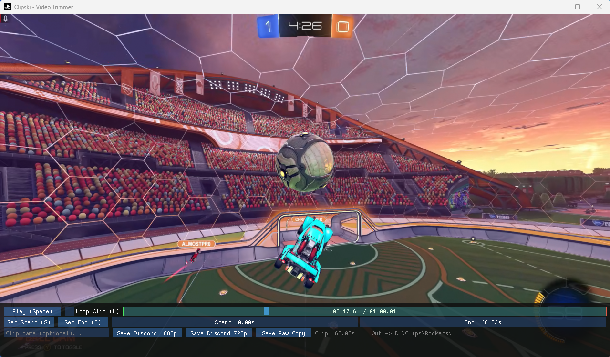

# Clipski

A fast, minimal, single-file C++17 desktop video trimmer for Windows built with **SDL2 (OpenGL)**, **libmpv**, and **Dear ImGui**. Designed for effortless game clipping directly from the Windows right-click menu.



---

## Features

- **Right-Click Context Menu Integration:** Right-click any video file (`.mp4`, `.mkv`, `.mov`, `.webm`, `.avi`) in Windows Explorer and select **Trim with Clipski** (or drag and drop files directly into the window).
- **Hardware-Accelerated Playback:** Powered by `libmpv` (`hwdec=auto`) rendering directly to an OpenGL 3.2 Core context with zero idle CPU usage (`SDL_WaitEvent` + `mpv_render_context_set_update_callback`).
- **Live Clip Loop Preview (`L`):** Toggle **Loop Clip** to lock playback and the timeline scrubber strictly between your `Start` and `End` trim points using `libmpv`'s hardware A-B loop.
- **One-Click Discord & Full-Quality Exports:**
  - **Custom Clip Naming:** Type an optional name (e.g. `"clean reset pop"`) to automatically format spaces as `-` (`clean-reset-pop.mp4`) and omit the `_compressed` suffix, or leave blank to use the original filename + preset suffix.
  - **Save Discord 1080p:** Exports `<name>_compressed_1080.mp4` (1080p60, 12 Mbps on GPU: ~33s fits under Discord's 50 MB).
  - **Save Discord 720p:** Exports `<name>_compressed_720.mp4` (720p60, 4 Mbps on GPU: a full 60s replay is ~29 MB).
  - **Save Full Quality:** Exports `<name>_full.mp4` at the source resolution and the source's own bitrate, cut exactly at your start/end points.
  - **Fast (GPU) toggle (on by default):** Encodes on the AMD GPU (`h264_amf`), about 10x faster than the old CPU presets. Turn it off to encode on the CPU (`libx264 -preset medium`), e.g. if GPU exports fail on a non-AMD card.
  - If the output file already exists, `_2`, `_3`, ... is appended instead of overwriting.
  - Runs `ffmpeg.exe` asynchronously in the background with no console popups or UI freezing.

---

## Hotkeys

| Key | Action |
| :--- | :--- |
| **`Space`** | Play / Pause |
| **`S`** (or **`I`** / **`[`**) | Set **Trim Start** to current timestamp |
| **`E`** (or **`O`** / **`]`**) | Set **Trim End** to current timestamp |
| **`L`** (or **`C`**) | Toggle **Loop Clip** mode (play only inside your trimmed range) |
| **`Left` / `Right` Arrow** | Seek backward / forward **1 second** |
| **`Shift + Left / Right`** | Seek backward / forward **5 seconds** |
| **`,` / `.`** (`<` / `>`) | Step backward / forward **1 exact frame** |

---

## Building on Windows

### Prerequisites
- **Visual Studio 2022** (with C++ Desktop workload) and **CMake 3.20+**
- **FFmpeg** (`ffmpeg.exe` available in your system `PATH`)
- **libmpv Windows Dev SDK** extracted into `external/mpv` (`include/mpv/*.h`, `libmpv-2.dll`, and MSVC import library `mpv.lib`).
  - *Note: `SDL2` and `Dear ImGui` are automatically downloaded and configured by CMake `FetchContent`.*

### Compile
```powershell
cmake -B build -S . -G "Visual Studio 17 2022" -A x64
cmake --build build --config Release
```
The compiled binary and required runtime DLLs (`SDL2.dll`, `libmpv-2.dll`) are output to `build\Release\clipski.exe`.

---

## Registering the Windows Right-Click Menu

Run the following in PowerShell (no Administrator privileges required) to add **Trim with Clipski** to your video file right-click context menu:

```powershell
$exePath  = "$PSScriptRoot\build\Release\clipski.exe"
$menuIcon = "$PSScriptRoot\assets\clipski_menu.ico"
$exts     = @(".mp4", ".mkv", ".mov", ".webm", ".avi")

foreach ($ext in $exts) {
    $regKey = "HKCU:\Software\Classes\SystemFileAssociations\$ext\Shell\Trim with Clipski"
    $cmdKey = "$regKey\command"
    New-Item -Path $cmdKey -Force | Out-Null
    Set-ItemProperty -Path $regKey -Name "(Default)" -Value "Trim with Clipski"
    Set-ItemProperty -Path $regKey -Name "Icon" -Value $menuIcon
    Set-ItemProperty -Path $cmdKey -Name "(Default)" -Value "`"$exePath`" `"%1`""
}
```

---

## Automatic Game Folder Routing (`clipski.ini`)

When you open a video located inside your configured `input_root` (e.g. `C:\Users\Andy\Videos\Radeon ReLive\<GameFolder>\<clip.mp4>`), Clipski automatically routes the exported clip to `output_root` (`D:\Clips\<GameFolder>\`), creating the destination folder if it doesn't exist yet.

To keep your Windows Quick Access names clean and distinct, you can map source game folder names to shorthand target folder names in [`clipski.ini`](clipski.ini):

```ini
[Paths]
input_root  = C:\Users\Andy\Videos\Radeon ReLive
output_root = D:\Clips

[Aliases]
Rocket League = Rockets
Baldur's Gate 3 = bg3
EA SPORTS College Football 27 = cfb
PEAK = peak
```

- **Aliased Game:** Opening `C:\Users\Andy\Videos\Radeon ReLive\Rocket League\clip.mp4` exports to `D:\Clips\Rockets\`.
- **New/Unlisted Game:** Opening `C:\Users\Andy\Videos\Radeon ReLive\Star Wars Galactic Racer\clip.mp4` automatically creates and exports to `D:\Clips\Star Wars Galactic Racer\`.
- **Outside `input_root`:** Opening any video outside `Radeon ReLive` exports directly alongside the original video file.

---

## Customizing FFmpeg Presets

Open [`src/main.cpp`](src/main.cpp) and edit the command templates at the top of the file:
```cpp
// CPU presets (Fast (GPU) toggle off)
static const std::string FFMPEG_ARGS_DISCORD_1080P_CPU = ...;
static const std::string FFMPEG_ARGS_DISCORD_720P_CPU  = ...;
static const std::string FFMPEG_ARGS_FULL_QUALITY_CPU  = ...;

// GPU presets (Fast (GPU) toggle on)
static const std::string FFMPEG_ARGS_DISCORD_1080P_GPU = ...;
static const std::string FFMPEG_ARGS_DISCORD_720P_GPU  = ...;
static const std::string FFMPEG_ARGS_FULL_QUALITY_GPU  = ...;
```
Then run `cmake --build build --config Release` to update `clipski.exe`.
